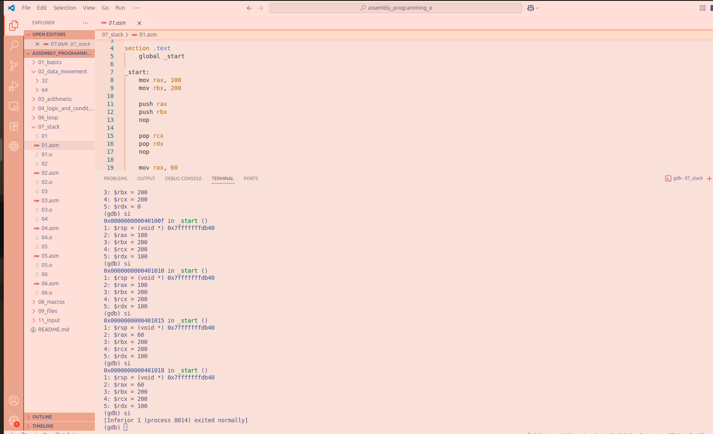

# File 01.asm

## Observations and explanations

**mov rax, 100**
- Moves 100 into the RAX register

**mov rbx, 200**
- Moves 200 into the RBX register

**push rax**
- 100 is pushed on the stack 
- RSP `0x7fffffffdb40` decreases by 8 bytes. RSP changes to `0x7fffffffdb38`

**push rbx**
- 200 is pushed on the stack
- RSP decreases by another 8 bytes.RSP changes to `0x7fffffffdb30`

**pop rcx**
- remove 200 from the top of the stack and store it in RCX. LIFO is used.
- RSP increases by 8 bytes. RSP changes to `0x7fffffffdb38`

**pop rdx**
- remove 100 from the top of the stack and store it in RDX
- RSP increases by another 8 bytes returning to `0x7fffffffdb40`

**mov rax, 60**
- selects the system exit call

**xor rdi,rdi**
- sets the exit status to 0

**syscall**
- terminates the program

## Conclusion
The program shows how PUSH and POP work on the stack.
100 and 200 are pushed onto the stack, then removed using POP. LIFO is used as 200 is removed first followed by 100. `RSP` decreases when values are pushed and increases when values are popped. At the end, `RSP` returns to its original value.

### **GDB Image**

