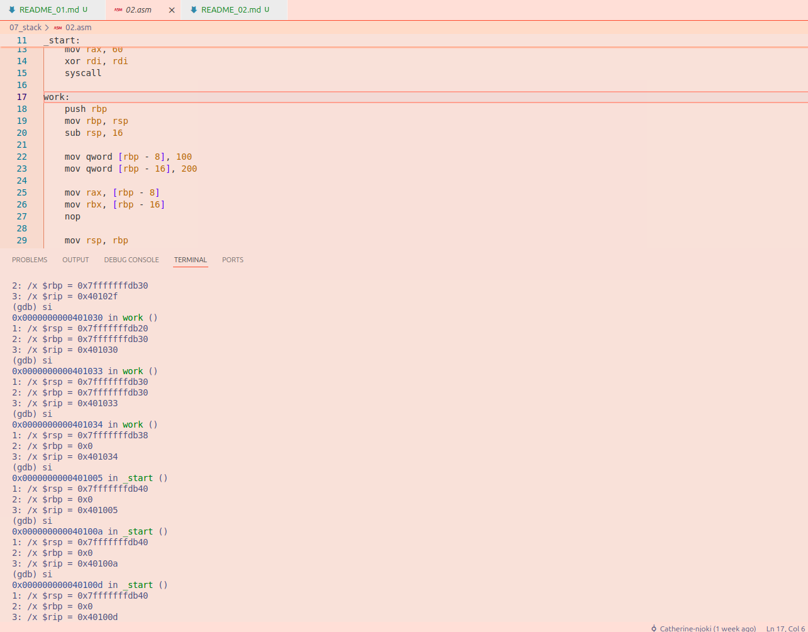

# File 02.asm

## Observations and explanations

**call work**
- It calls work section and pushes the return address onto the stack. RSP decreases by 8 bytes. RSP initial value was `0x7fffffffdb40` after this call it changed to `0x7fffffffdb38`

**mov rax, 60**
- It selects the system exit call

**xor rdi, rdi**
- It sets the exit status to 0

**syscall**
- It terminates the program

**work:**
- It marks the beginning of the work section

**push rbp**
- It saves the old RBP value on the stack
- RSP decreases by 8 bytes.RSP changed to `0x7fffffffdb30`

**mov rbp, rsp**
- RBP points to the current stack position. RSP remains unchanged.

**sub rsp, 16**
- 16 bytes of space is created on the stack for storing data. RSP changes to `0x7fffffffdb20`

**mov qword [rbp - 8], 100**
- 100 is stored in a memory location on the stack

**mov qword [rbp - 16], 200**
- 200 is stored in another memory location on the stack

**mov rax, [rbp - 8]**
- 100 is retrieved from the stack and put in RAX

**mov rbx, [rbp - 16]**
- 200 is retrieved from the stack and put in RBX

**nop**
- does not do anything

**mov rsp, rbp**
- It releases the 16 bytes of space that was created. RSP becomes `0x7fffffffdb30`

**pop rbp**
- It restores the old RBP value from the stack. RSP is `0x7fffffffdb38`

**ret**
- It returns to the instruction immediately after call work
- It will also remove the saved return address from the stack
- RSP increases by 8 bytes. RSP returns to its initial value, `0x7fffffffdb40`.

## Conclusion
The program shows shows how the stack is used when calling and returning from a procedure.
The old `RBP` value and return address are saved on the stack, while 16 bytes are reserved for the variables 200 and 100.
The values are retrieved from without being removed from the stack.
Then finally, the stack is released, the old `RBP` is restored and the program goes back to the main section. `RSP` returns its initial value of `0x7fffffffdb400000`

### **GDB Image**

