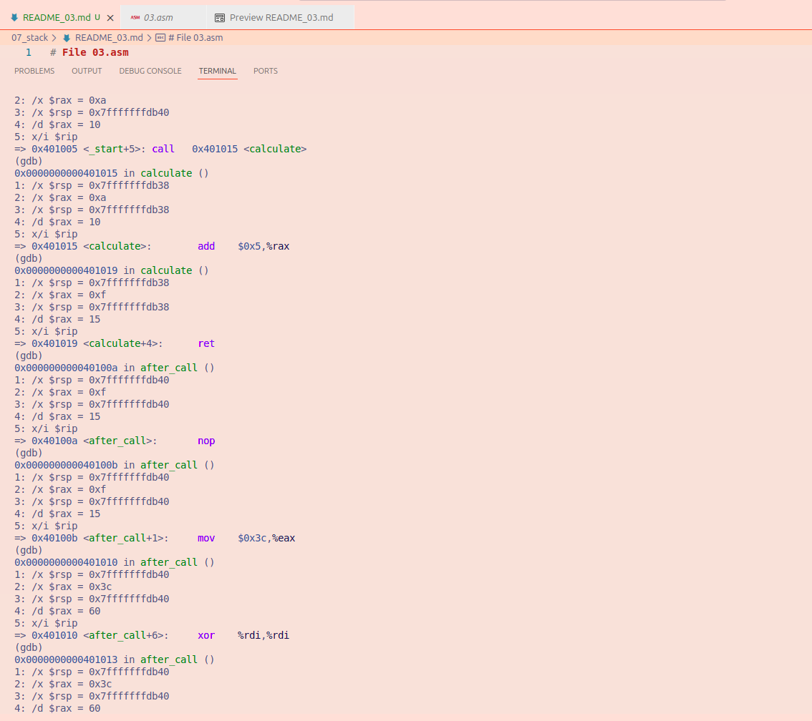

# File 03.asm

## Observations and explanations

**section .text**
- The program instructions are stored here

**global _start**
- Makes _start the entry point of the program

**_start:**
- This is where the program begins

**mov rax, 10**
- 10 is placed on RAX
- RSP remains `0x7fffffffdb40`

**call calculate**
- the calculate procedure is called and saves the return address on the stack.RSP decreases by 8 bytes. RSP changes to `0x7fffffffdb38`

**after_call:**
- marks where the program continues after calculate returns

**nop**

**mov rax, 60**
- selects the Linux system exit call

**xor rdi, rdi**
- sets the exit status to 0

**syscall**
- Terminates the program

**calculate:**
- Marks the beginning of the calculate procedure

**add rax, 5**
- 5 is added to the value in RAX and becomes 15. RSP is not changed
- RSP is `0x7fffffffdb38` .Add does not use the stack.

**ret**
- returns the saved return address from the stack and returns to the instruction after calculate is called. RSP increases by 8 bytes.
- RSP changes to `0x7fffffffdb40`

## Conclusion
This program shows how CALL and RET use the stack when executing a procedure. CALL saves the return address on the stack, decreasing `RSP` by 8 bytes. The calculation procedure adds 5 to the value in `RAX`, changing it from 10 to 15. `RET` retrieves the saved return address and returns to the main program. `RSP` returns to its original value of `0x7fffffffdb40`

### **GDB Image**

