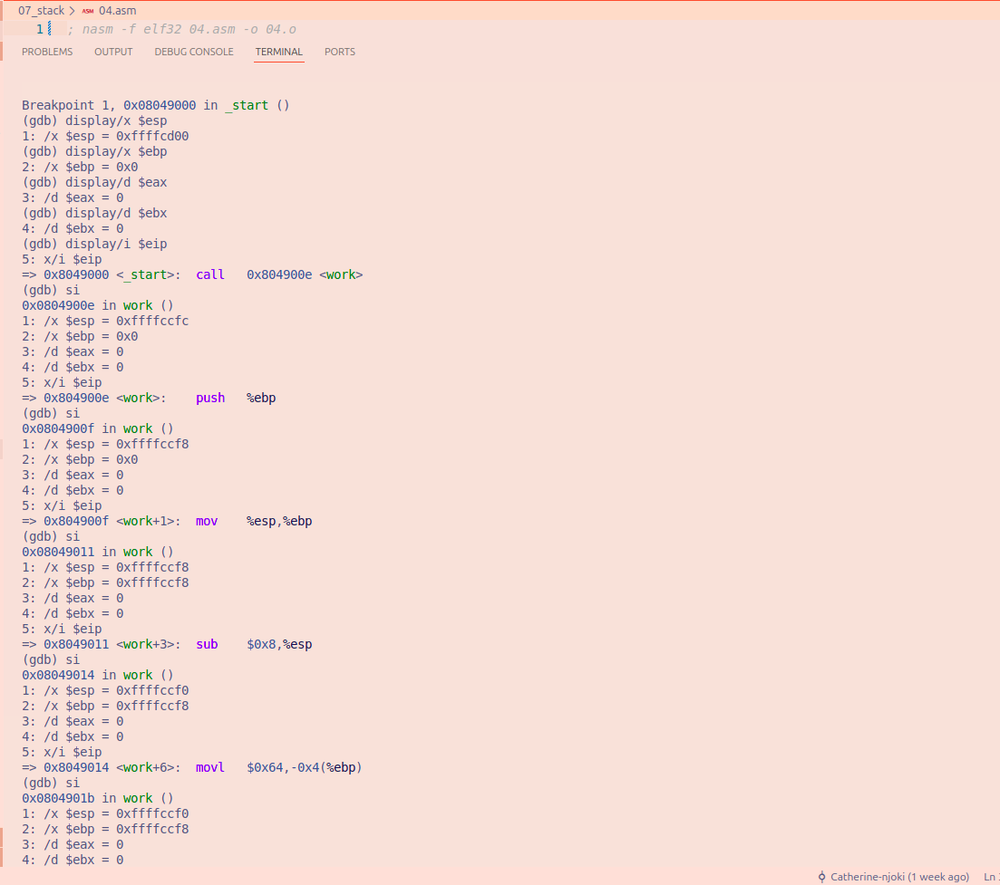
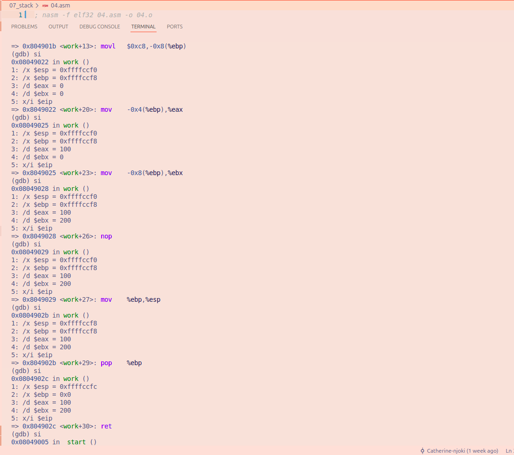

# File 04.asm

## Explanation and observations
- This is a 32-bit assembly program that uses ESP as the stack pointer and EBP as the frame pointer.It uses CALL, PUSH, POP and RET.

**section .text**
- The program instructions are stored here

**global _start**
- Makes _start the entry point of the program

**_start:**
- This is where the program begins

**call work**
- The procedure work is called. The return address is pushed onto the stack. `ESP` decreases by 4 bytes, from `0xffffcd00` to `0xffffccfc`
- The return address tells the program where to continue after the procedure finishes.

**mov eax, 1**
- selects the Linux 32-bit exit system call

**xor ebx, ebx**
- sets the exit status to 0

**int 0x80**
- requests termination of the program.

**push ebp**
- saves the previous `EBP` value on the stack. `ESP` decreases by 4 bytes. `ESP` changes from `0xffffccfc` to `0xffffccf8`

**mov ebp, esp**
- `EBP` is set to the current stack position using the value in `ESP`.`ESP` does not change. `ESP` remains `0xffffccf8`

**sub esp, 8**
- reserves 8 bytes for two local variables. `ESP` decreases by another 8 bytes. `ESP` changes from `0xffffccf8` to `0xffffccf0`

**mov dword [ebp - 4], 100**
- Stores 100 at the memory location EBP - 4

**mov dword [ebp - 8], 200**
- Stores 200 at the memory location EBP - 8

**mov eax, [ebp - 4]**
- loads 100 into EAX. This does not change ESP

**mov ebx, [ebp - 8]**
- loads 200 into EBX
- This does not change ESP

**nop**
- does nothing and ESP remains `0xffffccf0`

**mov esp, ebp**
- this releases the 8 bytes reserved for the local variables. `ESP` changes to `0xffffccf8`

**pop ebp**
- this restores the previous EBP value. ESP increases by 4 bytes.
- `ESP` changes to `0xffffccfc`

**ret**
- retrieves the saved return address and returns execution to the instruction immediately after call work. ESP increases by another 4 bytes, returning to its original value. `ESP` changes to `0xffffcd00`

## Conclusion
This program shows how a 32-bit stack frame is created and removed. CALL saves the return address, PUSH saves the previous EBP and SUB ESP reserves space for local variables. The values are loaded into EAX and EBX without removing them from the stack.
Then MOV ESP, EBP, POP EBP and RET restore the stack to its original position.

### **GDB Images**

