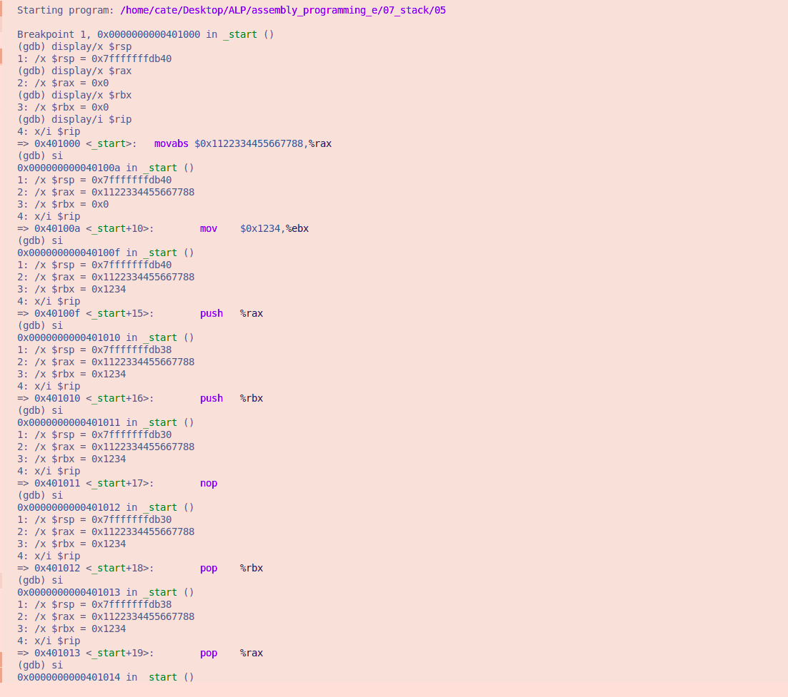
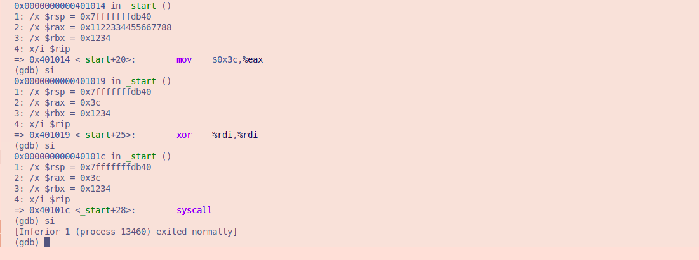

# File 05.asm

## Explanation and observations

**section .text**
- The program instructions are stored here

**global _start**
- Makes _start the entry point of the program

**_start:**
- This is where the program begins

**mov rax, 0x1122334455667788**
- stores 0x1122334455667788 in RAX

**mov rbx, 0x1234**
- stores 0x1234 in RBX

**push rax**
- places the value in RAX onto the stack. RSP decreases by 8 bytes. `RSP` changes from `	0x7fffffffdb40` to `0x7fffffffdb38`

**push rbx**
- places the value in RBX onto the stack. RSP decreases by another 8 bytes. `RSP` changes to `0x7fffffffdb30`

**nop**
- Does nothing. RSP remains `0x7fffffffdb30`

**pop rbx**
- retrieves the last pushed value (0x1234) into RBX. RSP increases by 8 bytes. `RSP` changes to `0x7fffffffdb38`
- Values are retrieved in reverse order

**pop rax**
- retrieves the earlier pushed value `0x1122334455667788` into RAX. RSP increases by another 8 bytes. `RSP` changes to `0x7fffffffdb40`
- LIFO is used.

**mov rax, 60**
- overwrites `0x1122334455667788` with 60 (or 0x3c) because RAX is needed to specify the Linux exit system call

**xor rdi, rdi**
- sets the exit status to 0.

**syscall**
- terminates the program

## Conclusion
The program shows how PUSH and POP work in a 64-bit stack.
PUSH stores values on the stack, while POP retrieves them in reverse order because the stack follows LIFO (Last In, First Out). Each PUSH decreases RSP by 8 bytes while each POP increases RSP by 8 bytes.

### **GDB Images**

