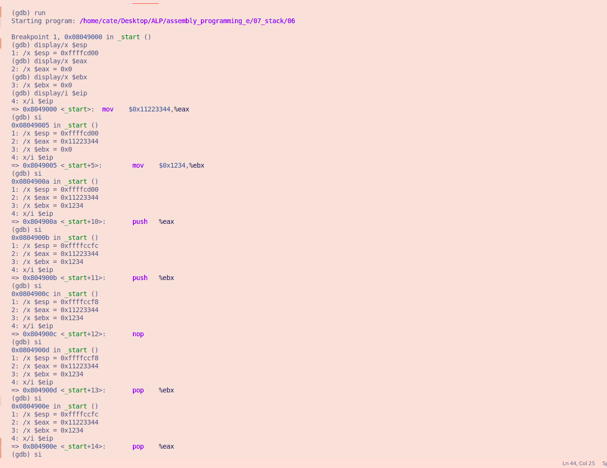
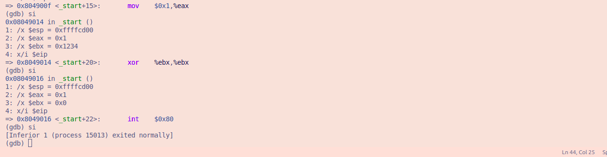

# File 06.asm

## Explanation and observations
- The initial stack pointer (ESP) is `0xffffcd00`

**BITS 32**
- This is a 32-bit assembly program 

**section .text**
- The program instructions are stored here

**global _start**
- Makes _start the entry point of the program

**_start:**
- This is where the program begins

**mov eax, 0x11223344**
- stores 0x11223344 in EAX

**mov ebx, 0x1234**
- stores 0x1234 in EBX

**push eax**
- places the value in EAX onto the stack. ESP decreases by 4 bytes. `ESP` changes from`0xffffcd00` to `0xffffccfc`

**push ebx**
- places the value in EBX onto the stack. ESP decreases by another 4 bytes. `ESP` changes to `0xffffccf8`

**nop**
- Does nothing. ESP remains 0xffffccf8

**pop ebx**
- Retrieves the last pushed value `0x1234` into EBX. ESP increases by 4 bytes. ESP changes to `0xffffccfc`

**pop eax**
- Retrieves the earlier pushed value `0x11223344` into EAX. ESP increases by another 4 bytes, returning to its original value of `0xffffcd00`

**mov eax, 1**
- selects the Linux 32-bit exit system call
- overwrites `0x11223344` with 1 because EAX is used to specify the Linux 32-bit exit system call.

**xor ebx, ebx**
- sets the exit status to 0

**int 0x80**
- terminates the program

## Conclusion

This program demonstrates how PUSH and POP work in a 32-bit stack. PUSH stores values on the stack, while POP retrieves them in reverse order. Each PUSH decreases ESP by 4 bytes, and each POP increases it by 4 bytes. The stack follows LIFO (Last In, First Out).

### **GDB Images**

